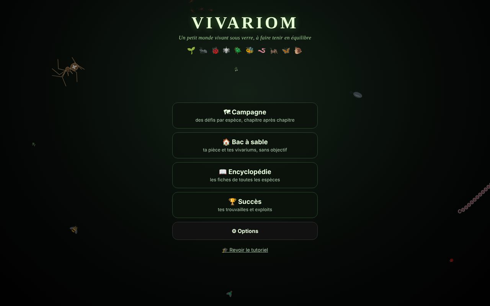
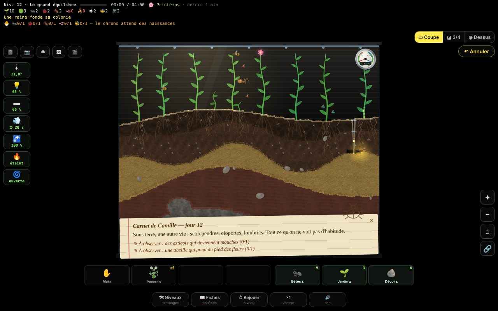
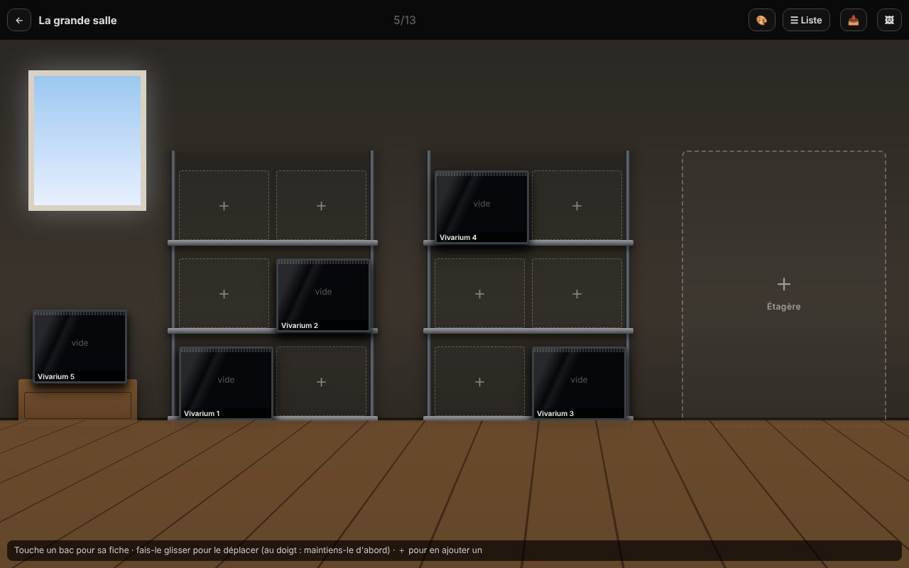
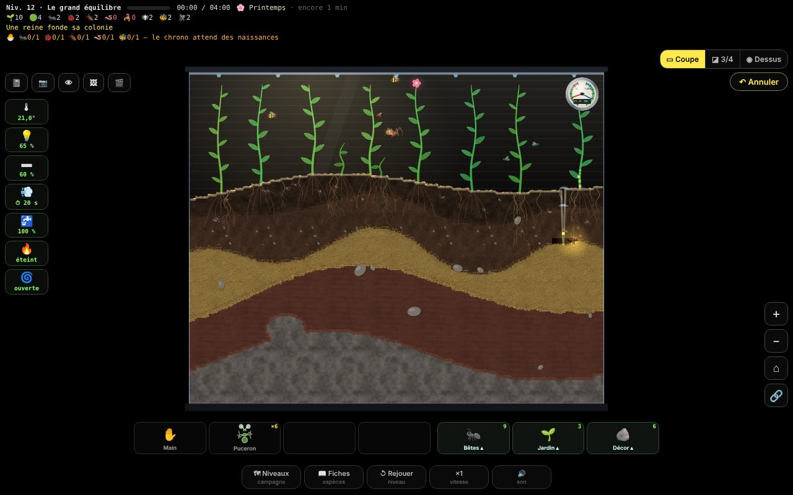
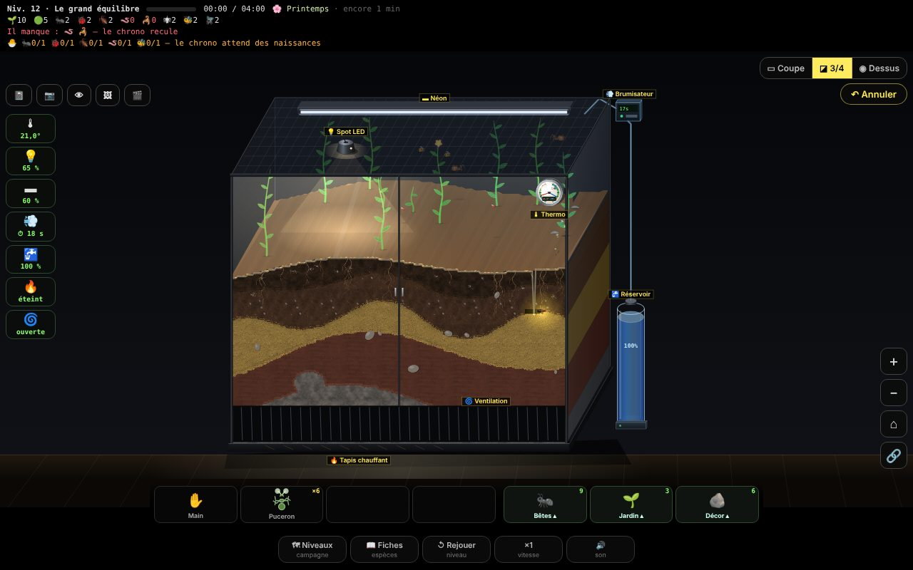
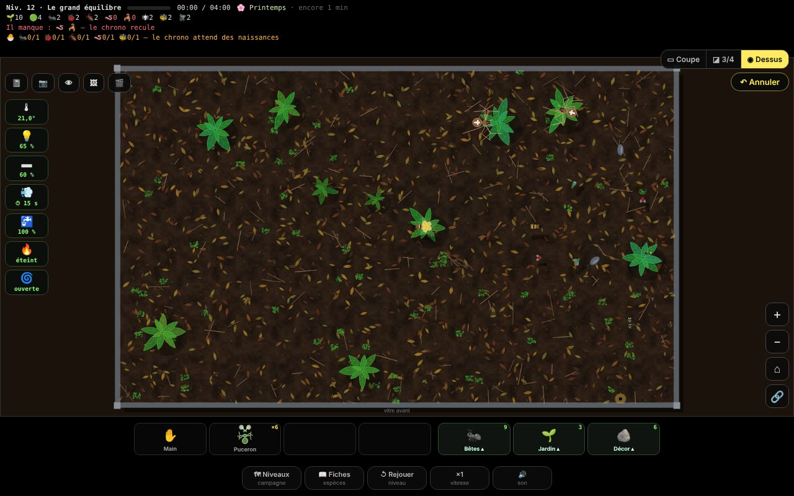
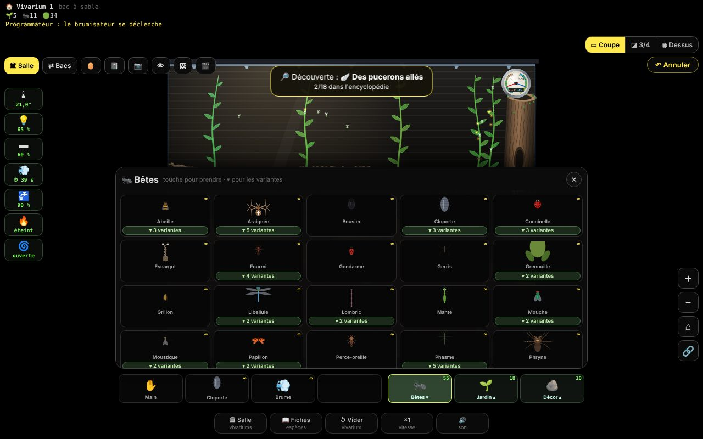
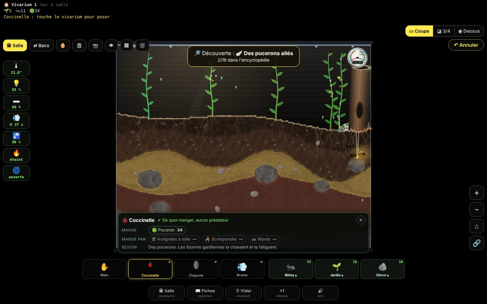
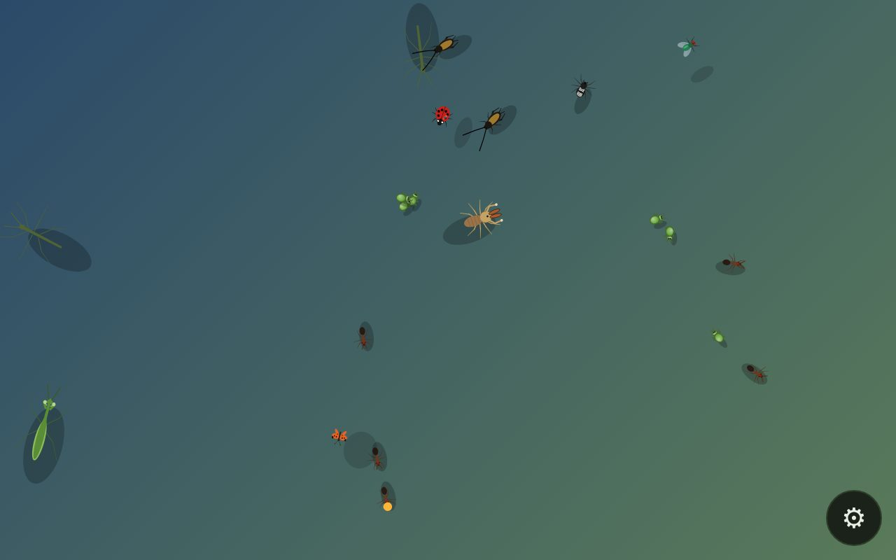

# 🐜 Vivariom

**Un petit monde vivant sous verre, à faire tenir en équilibre.**

Vivariom est un vivarium d'insectes que tu fais vivre : tu poses la terre, les plantes, les bêtes et le matériel, puis tu regardes l'écosystème s'organiser… ou s'effondrer. Fourmis qui creusent leurs galeries, araignées qui tissent, mantes à l'affût, papillons qui pondent sur les feuilles, scorpions qui chassent la nuit : chaque espèce a ses besoins, ses proies et ses prédateurs.

### ▶ [Jouer maintenant](https://grecdel.github.io/vivariom/)

Le jeu fonctionne dans le navigateur, sur **téléphone Android** comme sur **ordinateur (Windows, Linux)**, et s'installe comme une appli pour jouer **sans internet**. Il existe en **français** et en **anglais**, avec des réglages d'accessibilité (textes plus grands, contraste fort, couleurs adaptées au daltonisme).

---

## Ce qu'on y fait

### Une campagne de 22 niveaux
Neuf chapitres pour découvrir les espèces une à une : les premières pousses, la fourmilière, les coccinelles contre les pucerons, la toile de l'araignée, le grand équilibre, les phasmes, la mante religieuse, la métamorphose du papillon, le désert du scorpion, le bousier, le scarabée rhinocéros… Chaque niveau a un objectif (garder toutes les espèces en vie pendant un temps donné), des réserves limitées et jusqu'à trois étoiles à gagner.

Trois difficultés : **Facile** pour découvrir, **Normal** et **Expert** avec des réserves plus justes, des naissances à obtenir avant que le chrono démarre, et des coups durs annoncés (canicule, nuit froide, panne du brumisateur, invasion de pucerons, intrus). Les saisons passent : le printemps relance tout, l'hiver ralentit les bêtes. À la fin de chaque niveau, un bilan montre les courbes des populations, les naissances et les morts.

**Le carnet de Camille** : une jeune naturaliste ouvre chaque niveau par une page de son carnet de terrain, te donne deux observations à faire (une éclosion, une ponte, une chasse…) et commente ce qui se passe dans ton vivarium. Les pages gardées se relisent dans le livre 📔.

### Des défis en plus
- **Défi de chapitre** : le dernier niveau du chapitre, en plus dur.
- **Défi du jour** : un vivarium tiré au sort, le même pour tout le monde ce jour-là.
- **Survie** : tenir le plus longtemps possible pendant que les coups durs s'enchaînent.
- Des succès à décrocher, une **carte des chapitres** en forme de jardin, un **quiz** qui débloque des décorations, et des **découvertes** à observer (une éclosion, une chasse, une métamorphose, la lueur du ver luisant…).

### Un bac à sable
Tout est débloqué. Une grande salle avec des étagères accueille tes vivariums : touche un **＋** pour en créer un, choisis son format (standard, grand bac, fourmilière étroite, cube, **mur vivant** de 120 cm) et son sol (forêt, désert, marais), ajoute des étagères, range les bacs par glisser-déposer. Quand tu prends une bête, une **fiche d'aide** t'indique ce qu'elle mange, qui la mange (et combien il y en a déjà dans le bac) et ce dont elle a besoin.

Chaque bac a son **climat** (tempéré, tropical, désert) et son étiquette de couleur ; on peut partir d'un **modèle tout prêt** (forêt, désert, mare, **à étages** avec terrasses, souche, mare et lierre grimpant). Le vivarium **continue de vivre pendant ton absence**. Un bac se **partage** avec un ami par un code ou un fichier. Les photos se rangent dans un **album**, le carnet de bord garde la date de chaque événement, et le **mode observation** cache toute l'interface pour regarder tranquillement ; la **visite guidée** 🎬 promène la caméra d'une bête à l'autre en plein écran. Sur tablette, la fiche de la bête s'affiche à côté du bac.

### Trois façons de regarder
- **En coupe** : le vivarium de face, la terre, les racines et les galeries.
- **En 3/4** : le bac en volume avec son matériel (spot, néon, brumisateur, réservoir, tapis chauffant, ventilation).
- **Du dessus** : à l'échelle réelle, avec les décors (pierres, tronc creux, mare, mousse, écorce…).

On passe de l'une à l'autre avec les boutons, la molette ou en pinçant l'écran ; la bascule 3/4 ↔ dessus fait pivoter le bac en volume.

| En coupe | En 3/4 | Du dessus |
|---|---|---|
|  |  |  |

### Des bêtes qui ont leur vie
Une trentaine d'espèces et leurs variantes (fourmi noire, fourmi champignonniste, mygale bleue, coccinelle asiatique, bourdon, phasme-feuille, phasme épineux…), dessinées d'après nature : huit pattes articulées, chélicères et pédipalpes des araignées, antennes coudées et mandibules des fourmis, élytres striés des scarabées, ailes nervurées, et chaque bête à sa taille réelle à côté des pierres et des branches :
- les **fourmis** fondent une colonie autour de leur reine, creusent des galeries ramifiées et élèvent les pucerons pour leur miellat ;
- l'**épeire** tisse une toile ronde, la **mygale** guette à l'entrée de son terrier, l'**araignée sauteuse** bondit sur ses proies ; toutes gardent un cocon d'œufs ;
- la **coccinelle** pond près des pucerons, l'**abeille** butine et se pose la nuit, la **mouche** pond sur ce qui pourrit ;
- le **papillon** pond sur les feuilles, la chenille se change en chrysalide ; le **ténébrion**, le **scarabée rhinocéros** passent par la larve et la nymphe ;
- le **scorpion** se cache le jour, brille sous la lumière UV et porte ses petits sur son dos ;
- le **grillon** chante la nuit, le **ver luisant** s'allume dans le noir et chasse les escargots ; la **solifuge** du désert court la nuit après ses proies ; la **phryne** des forêts tropicales, toute plate, tâte le noir avec ses deux longs fouets et attrape ses proies avec ses pédipalpes épineux ;
- la **mare** est une vraie étendue d'eau : le **têtard** devient **grenouille**, la larve de libellule devient **libellule**, celle du moustique devient **moustique**, et les **gerris** glissent à la surface ; on y croise aussi le **perce-oreille** et le **gendarme** ;
- les **fourmis champignonnistes** découpent des feuilles pour cultiver leur jardin de champignon, les abeilles trop nombreuses partent en **essaim** ;
- les pucerons trop serrés **s'envolent** vers une autre plante, les colonies de fourmis rivales **se font la guerre**, un sol détrempé fait pousser des **moisissures** et rend les bêtes malades ; les plantes aussi peuvent tomber malades (virus apporté par les pucerons, taches brunes quand c'est trop humide). Une carte d'aide explique comment soigner, et en Facile elle peut le faire pour toi ;
- les petits **grandissent**, les vieilles bêtes ralentissent ; coccinelles et mouches passent par la **larve et la nymphe**.

Côté plantes : fleurs, fougères (même arborescentes), graminées, trèfle, ronce, cactus, champignons, et une **dionée** carnivore qui attrape les mouches. Les fleurs pollinisées donnent des fruits. La terre change selon le biome : humus et feuilles mortes en forêt, terre rouge sous les tropiques, sable ridé par le vent et grès au désert, vase et argile grise au marais, avec racines, cailloux et galeries visibles en coupe comme vus du dessus. Les tiges ondulent, ploient sous le poids d'une bête et oscillent quand un insecte s'y pose ; les toiles vibrent et le sable bouge sous les pattes.

Sélectionne une bête pour savoir ce qu'elle est en train de faire : chasser, creuser, garder ses œufs, se reposer… Garde le doigt appuyé sur elle pour la **suivre** avec la caméra, et ouvre la **loupe** pour la voir en gros plan.

| Le tiroir des bêtes | La fiche d'aide |
|---|---|
|  |  |

### Pour tous
Textes plus grands, contraste fort, couleurs pour daltoniens, version anglaise, **mode enfant** (textes simples, plus d'aide, pas de mort affichée) et **notifications** facultatives (« Tes pucerons ont envahi le bac ! »).

### Le matériel du vivarium
Une barre compacte montre l'état de chaque appareil (température, lumière, prochaine brumisation, niveau du réservoir…) ; un clic ouvre ses réglages. La lumière fait pousser les plantes mais chauffe et assèche, le brumisateur humidifie, le tapis chauffant accélère tout le monde.

### Un bug, une idée ?
Le bouton **✉ Un bug, une idée ? Écris-nous** (menu du jeu, ou Options → Contact) ouvre un petit formulaire. Ton message arrive dans la page [Issues](https://github.com/grecdel/vivariom/issues) du projet.

---

## Installer le jeu comme une appli

1. Ouvre **https://grecdel.github.io/vivariom/** dans Chrome ou Edge.
2. **Ordinateur** : bouton « Installer » dans la barre d'adresse. **Android** : menu ⋮ → « Ajouter à l'écran d'accueil » (ou « Installer l'application »).
3. Le jeu se lance ensuite comme une appli, même sans internet, et se met à jour tout seul.

**Passer sa partie d'un appareil à l'autre** : Options → Données → Sauvegarde → exporter un fichier ou un code, puis l'importer sur l'autre appareil.

---

## 🐞 Bonus : les Bestioles

Des petites bêtes de Vivariom qui se promènent **directement sur ton écran**, par-dessus tes applis, sans rien toucher : des fourmis en file qui rapportent des miettes, des pucerons et la coccinelle qui les mange, des mouches, une araignée sauteuse qui les guette, un papillon, une mante à l'affût, un phasme qui se balance comme une brindille, un grillon qui chante la nuit, et même une solifuge. Elles sont dessinées comme dans le jeu, et vivent ensemble : les fourmis défendent leurs pucerons contre la coccinelle, la mouche s'envole quand l'araignée approche… Elles ne gênent jamais : tes touchers et tes clics passent toujours à travers. Les options s'ouvrent par le bouton ⚙ du widget, de la notification ou de l'icône près de l'horloge, avec un lien pour lancer Vivariom. Tu choisis quelles espèces apparaissent et combien, tu peux poser une miette ou une goutte de miel, les bêtes fuient la souris (ou la suivent si tu tiens une miette), et la nuit, les papillons laissent la place aux vers luisants.

**Télécharger** : page [Releases → Bestioles](https://github.com/grecdel/vivariom/releases/tag/bestioles)

| Système | Fichier | Allumer / éteindre |
|---|---|---|
| **Android** | `Bestioles-android.apk` | widget sur l'écran d'accueil, bouton dans les réglages rapides, ou notification |
| **Windows** | `Bestioles-windows.exe` | icône près de l'horloge (clic) ; option « lancer au démarrage » |
| **Linux** | `Bestioles-linux.AppImage` | icône près de l'horloge (menu) ; option « lancer au démarrage » |

À savoir :
- **Android** : autorise l'installation d'applications inconnues, puis, dans l'appli Bestioles, « afficher par-dessus les autres applis ».
- **Windows** : au premier lancement, « Windows a protégé votre ordinateur » → *Informations complémentaires* → *Exécuter quand même* (l'appli n'est pas signée).
- **Linux** : rends le fichier exécutable (clic droit → Propriétés → Autoriser l'exécution). Sur certains bureaux récents (GNOME/Wayland), l'icône demande une extension et les bêtes peuvent passer derrière certaines fenêtres.

---

## Pour les curieux

Le jeu est écrit en JavaScript, dessiné sur un canvas, et assemblé en un seul fichier HTML (`python3 assemble.py`). Les Bestioles réutilisent une même page pour les trois systèmes, emballée dans une appli Android (Kotlin) et une appli de bureau (Electron). Les applis sont fabriquées automatiquement par GitHub Actions.

---

© 2026 grecdel — tous droits réservés. Le code est visible mais **n'est pas libre** : toute copie, modification ou redistribution est interdite sans accord écrit. Voir [LICENSE](LICENSE).
